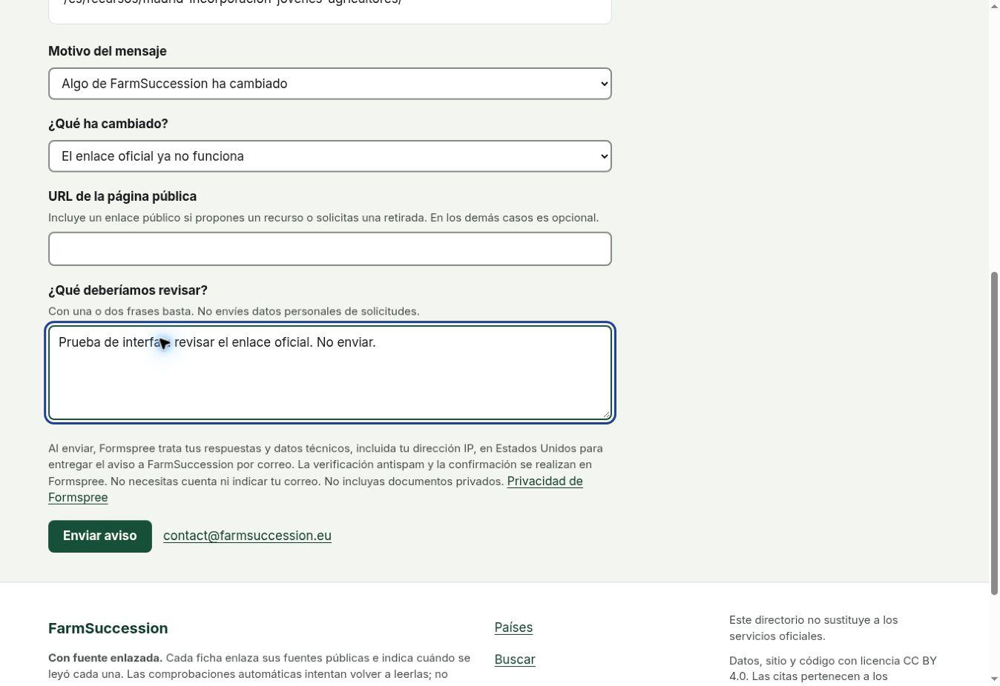
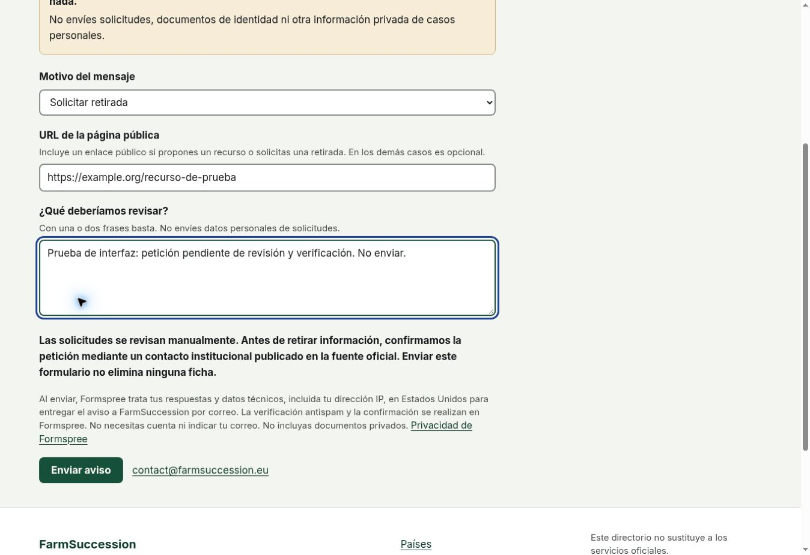

# 037 — Public reports use explicit form delivery

**2026-11-07. Status: Formspree selected; integration implemented, account activation pending.**
The maintainer wants visitors to submit a short form rather than compose an email.
This records the selected provider, the complete existing-form inventory and
the implemented integration and the remaining activation work. This PR adds native
Formspree delivery when configured; no operational endpoint is committed.

## The question

Should reports continue through the visitor's mail application, or should an external
service deliver them to the maintainer? The first keeps the present architecture;
the second removes a dependency that prevents some visitors from sending anything.

## What the evidence said

The site is a static GitHub Pages build. Decision [030](030-public-correction-stays-outside-github.md)
chose email and explicitly permits reconsideration while retaining no third-party
request merely from opening a page. The maintainer has now requested a free delivery
alternative. No measured submission or abandonment rate is claimed.

Provider documentation checked on **7 November 2026**:

| Option        | Free allowance and destination                                                                               | Fit and limitations                                                                                                                                                                                                                                                       |
| ------------- | ------------------------------------------------------------------------------------------------------------ | ------------------------------------------------------------------------------------------------------------------------------------------------------------------------------------------------------------------------------------------------------------------------- |
| **Formspree** | 50 submissions per month per account; email notifications and a dashboard with 30 days of submission history | Native HTML POST preserves our forms and works without JavaScript. No visitor account needed. Free includes basic spam filtering and domain restriction, but not submission export, integrations or a custom thank-you redirect. The confirmation is hosted by Formspree. |
| **Tally**     | Unlimited forms/submissions subject to fair use; free native Google Sheets integration                       | Prefer this if a spreadsheet or a larger free allowance matters more than retaining our form UI. Use a hosted-form link, not an embed that contacts another host during reading. Tally states it is based in Belgium and stores form data in Europe.                      |
| **Web3Forms** | 250 submissions per month; email delivery and CSV export                                                     | Another direct-POST option. Current pricing/privacy pages describe stored submissions, potentially up to three years, and international processing. Do not rely on older FAQ wording that says submissions are not stored.                                                |

Sources:

- Formspree [plans](https://formspree.io/plans), [HTML setup](https://formspree.io/html/),
  [account limits](https://help.formspree.io/articles/account-management/account-limits),
  [limit errors](https://help.formspree.io/articles/form-and-project-settings/system-limits),
  [honeypot](https://help.formspree.io/articles/building-your-form/honeypot-spam-filtering),
  [reCAPTCHA settings](https://help.formspree.io/articles/form-and-project-settings/recaptcha-settings/),
  [privacy](https://formspree.io/legal/privacy-policy/) and
  [US hosting](https://formspree.io/security/).
- Tally [free plan and hosting](https://tally.so/help/faq) and
  [Google Sheets integration](https://tally.so/help/google-sheets-integration).
- Web3Forms [pricing](https://web3forms.com/pricing) and
  [privacy](https://web3forms.com/privacy).

These are current allowances, not a promise that a provider will remain free forever.
No paid plan, trial upgrade or cloud billing account is needed for the proposed scope.

### Existing forms and what must migrate

One message form lives in
[`frontend/src/pages/[...report].astro`](../frontend/src/pages/[...report].astro),
with a reason selector. Existing links retain `?type=missing`, `correction`,
`looking`, `feedback` or `removal` to preselect the reason and carry their context. Changing the
reason updates the fields and subject in place without discarding the message.
`ReportDelivery.astro` supplies one configured native POST or the email fallback.

| Reason                                 | Entry points                                                            | Relevant information                                                                                               |
| -------------------------------------- | ----------------------------------------------------------------------- | ------------------------------------------------------------------------------------------------------------------ |
| `missing`: suggest a resource          | Country, region, grouping and EU directory links; project contact page  | Public source URL and a message identifying the resource                                                           |
| `correction`: report a change          | Resource detail and project contact page                                | Issue category, message, optional replacement URL and originating record context                                   |
| `looking`: report an unmet search      | No-results offer in `SearchView.astro`, populated by `public/search.js` | Editable prefilled search wording, optional place and originating search context                                   |
| `removal`: request a review of removal | Footer, project page or the shared selector                             | Affected public URL, message and the independent-verification notice; never an instruction to delete automatically |

The shared selector also accepts `feedback` from a record's “tell us what was
missing” action. It preserves the originating record, territory and page. Its
message label asks what would make the record useful and suggests clarity, links
or a next step, without requiring a second URL. It uses the same delivery,
provider-hosted CAPTCHA, privacy notice and editorial review as other messages.
This is a written comment, not a saved yes/no vote or an automatic content change.

Relevant entry-point files are `src/pages/[...territory].astro`,
`src/pages/[...record].astro`, `src/pages/[...about].astro`,
`src/components/SearchView.astro` and `public/search.js`, all under `frontend/`.
The selector sends a single `kind`; there is no competing hidden reason value.
Language and subject accompany it. Inapplicable issue/place controls are hidden
and disabled by the first-party enhancement, so stale answers are not sent.

The message and reason are required in native HTML. JavaScript additionally
requires the URL for resource suggestions and removal requests. Without JavaScript
all controls remain available and the URL hint explains when to include it, but
its requirement cannot follow a changed selector in static HTML. Submitted fields
are untrusted in every case: the maintainer verifies a public source before any
editorial action. The resource name can be included in the message; a separate
optional name field is no longer needed.

The current catalogue builds **seven intake routes**: EU, DE, ES, FR, IT, PT and AT;
Austria shares German interface words. Each route now contains **one form**,
replacing the earlier 28 rendered forms. Routes derive from the catalogue, with
no hard-coded country list. All seven interface dictionaries, including Dutch,
contain the shared-form and verification wording without adding a territory.

### Other form-like and email entry points

- `SearchBox.astro` and `SearchView.astro` contain **search GET forms**. Keep these
  local: ordinary search terms must never be sent to the report service. The
  no-results link leads to an editable report; it must not submit automatically.
- The resource detail page has both a correction button and email-only helper copy.
  Make the form the primary correction action and the printed address an alternative.
- `Footer.astro` and the project page offer **removal requests only by email**.
  This gap is now covered by a distinct `removal` intake kind
  with the affected public URL and a short explanation. Preserve direct email as an
  alternative, especially for a person who does not want to use another processor.
  Do not label a removal request as a broken link or automatically remove records.
- Institutional email addresses in a resource's **provider contacts** are different:
  they contact the documented service. Keep them pointed at that service; never
  redirect them into FarmSuccession's inbox.
- No existing file-upload, newsletter, account-registration or application-submission
  form was found. Do not introduce these as part of this change.

Reproduce the source inventory from the repository root:

```bash
rg -n '<form|mailto:|reportSlug|data-not-found-link' frontend/src frontend/public --glob '!words.ts'
```

## The decision

**Use Formspree Free for the existing UI.** The maintainer selected this option after
reviewing the alternatives. The integration is implemented; account configuration and activation
remain pending; there is no operational endpoint in this PR.
It removes the mail-client dependency without adding our own backend, SDK, secret
or deployment. Tally remains the documented alternative if the free spreadsheet
integration or higher allowance is the priority. Do not configure both by default:
duplicating receipts into extra services adds work and data copies.

Implementation requirements:

1. Use native HTML `POST` to one fixed, validated public Formspree `/f/…` endpoint.
   This endpoint is public configuration, not a credential. Never put an account/API
   secret in Git, the HTML or browser JavaScript. The query string must not select
   the destination. Keep the current context prefill and selected report section.
2. Permit the chosen origin in CSP `form-action` only when configured; retain
   `connect-src 'self'` and first-party-only scripts/assets. A page load, typing,
   search or field edit must make no request to the provider. Do not add a widget,
   embed, remote CAPTCHA script, preconnect, analytics, cookie or browser storage.
3. Explain beside the send action, in the page's language, that submitting sends
   the answers and technical request data, including IP address, to Formspree for
   delivery to FarmSuccession. Identify its US processing and link its privacy
   policy. Update the project privacy section and clarify the reading/submitting
   distinction recorded in `AGENTS.md` and decision 030. An external
   confirmation page has the provider's own privacy behaviour; our site's browser
   guarantees cannot be claimed for that page.
4. Require neither a visitor account nor a name/email. Do not request attachments,
   identity details or private application papers. Treat submitted text/context as
   untrusted. Every report remains a lead for human investigation, never publication.
5. Add the standard `_gotcha` honeypot, basic provider spam filtering and domain
   restriction. Enable provider-hosted reCAPTCHA before activation, on the Free form's
   Settings → Spam protection screen. The challenge happens on Formspree after
   explicit POST; never embed Google's script on our pages. Retain the honeypot
   as an additional filter. A CAPTCHA distinguishes likely humans from bots;
   it does not establish identity, authority to represent an organisation or
   correctness of the request. Domain restriction is an origin/spam filter,
   not identity verification either.
6. Use a clear localized “Send report” action. Keep the visible email alternative.
   Let the provider own the native POST confirmation/error; do not show a local
   success message before acceptance. Do not assume a paid custom redirect is free.
   If JavaScript delivery is later chosen, handle rejection, quota/rate-limit,
   network failure and repeated clicks explicitly, preserving the entered answers.
7. Until an endpoint is configured, preserve the honest email-draft flow and its
   existing labels. Do not ship a fake endpoint, disabled send button or success
   screen for a message that has gone nowhere.

### Removal requests require independent verification

A public report can request investigation; it cannot delete, hide or unpublish a
record. The static browser code has no repository credential, mutation endpoint or
publication job. Formspree delivers to an inbox; it has no authorised path to edit
the corpus. Do not later connect these messages to an automated deletion workflow.

Before acting on a removal request, the maintainer reviews its scope and reason
and confirms the request through an institutional channel independently obtained
from the official source or existing documented provider contact. Do not treat
an address, phone number or link supplied in the message as proof of authority.
An email input, email-shaped text, CAPTCHA completion or knowledge of a public
record URL is not identity verification. A forged, unconfirmed or bulk request
must not trigger removal. Any resulting editorial change follows the ordinary
repository review and publication process; no form gets to bypass it.

The removal form now explains this review boundary in every language, including
in the email fallback. Legacy wording promising unconditional removal is replaced.
On 7 November the maintainer requested this stricter protection; it replaces the
earlier suggestion to start with CAPTCHA disabled. Real CAPTCHA activation and
challenge testing remain pending the provider account, just like inbox receipt.

### Remaining maintainer configuration

The shared transport, per-form privacy disclosure, metadata, honeypot, conditional
CSP and removal links are implemented. One reason selector updates the shared form in place and preserves the message
and original page context. Native HTML remains usable without JavaScript. Every interface dictionary includes the new wording. Configure
one location: `frontend/reporting.config.mjs`, whose `reportEndpoint` is intentionally
empty until the maintainer supplies the real public form URL.

The following account/receipt work has **not** been performed:

1. The maintainer creates a **Free** Formspree account/form and verifies
   `contact@farmsuccession.eu` as the notification destination. Review the applicable
   processor terms and international-transfer provisions before enabling collection.
   Do not subscribe to a paid plan or use a trial as the free solution.
2. Configure notification delivery and the allowed production domain; **enable
   hosted reCAPTCHA in Formspree's Spam protection settings**. This cannot be
   enabled or proved by a hidden HTML field: it is a provider-account setting.
   Check the hosted challenge and acceptance with the real configured account.
   Do not assume it is enabled merely because the integration is present.
   Set `reportEndpoint` in `frontend/reporting.config.mjs` to the public `/f/…` URL,
   then rebuild the static site. Recheck
   current free allowances and settings at activation; all report kinds share the
   account's 50-submission monthly allowance.
3. Keep provider management access private. No user-submitted reports,
   inbox contents or personal test data belong in this public repository.
4. Complete the live receipt checks below, then let the maintainer decide when to publish. Record
   the activation state and configuration instructions here so another implementer
   does not mistake a configured UI for a verified operational inbox.

## What it costs

This introduces an external processor **on submission** and an account the maintainer
must own. Formspree uses US infrastructure. Free history is 30 days, which is not a
promise that every technical log or backup is deleted after 30 days; emails also
remain in the receiving mailbox under the maintainer's retention policy.

The account-wide free quota is a real limit. Formspree documents an error response
when limits are reached; visitors must not be told their report was delivered then.
The native confirmation takes them off-site. Spreadsheet integration/export is not
included in this free option; use Tally if that becomes a requirement.

### Acceptance and browser checks before activation

- Update `frontend/test/reporting.test.ts` for configured and unconfigured builds.
  Check every catalogue-derived intake route, its single form, reason-specific
  controls and preserved context, localized privacy wording and provider subject.
- Keep `frontend/test/built-site.test.ts` strict: no remote asset/script or background
  connection, no storage, no inline JavaScript; only explicit form delivery gains
  the named CSP exception. Run both root and frontend `npm run check`.
- In a real browser, follow a correction from the Madrid young-farmer record, a
  missing-resource link from Cataluña and a no-results search offer. Confirm the
  selected form, original page, territory, record/category and editable search text.
  Also check project/footer removal links and an institutional provider email.
- Exercise validation and delivery without JavaScript, the unconfigured fallback,
  narrow layouts and keyboard use. For an eventual AJAX implementation, use a local
  test stub for failure/rate-limit scenarios; do not exhaust a live free quota.
- With the real account, verify that hosted CAPTCHA rejects or challenges unverified
  submissions and that a legitimate submission reaches the inbox. Do not solve a
  live challenge without the required user confirmation. Inspect the provider spam
  inbox as well as notifications. Verify a fictitious removal request cannot change
  the published corpus and does not result in an automatic deletion action.
- Opening any page and editing its fields must produce **zero provider requests**.
  A submit must send exactly the intended fields. With the maintainer's configured
  account, use clearly marked fictional reports to verify each kind reaches the
  inbox/dashboard and the provider displays a genuine confirmation. Check rejection
  behaviour, record the results and add representative screenshots to the PR.

No provider account, real submission or inbox receipt is claimed. Browser and build
verification of the configured interface uses a temporary fixture URL only; the
fixture is never submitted and is not the committed configuration. The earlier UX
screenshots exercise the email draft, not provider delivery.

### Verification of the unified implementation

- Root `npm run check` passes 251 tests, with the existing corpus warning/review
  unchanged and no corpus errors. Frontend `npm run check` passes 159 tests in
  both configured-fixture and final unconfigured builds. The reduction from the
  earlier 161 reflects replacing split-form assertions with shared-form checks,
  not skipping tests. Every catalogue-derived route contains exactly one form.
- Interaction regression checks cover preselected reason, preserved editable
  message/context, changing subjects, required URL for suggestion/removal,
  disabled irrelevant controls and the independent removal-verification notice.
  Configured delivery is not intercepted by the script; the unconfigured email
  draft remains selectable and obsolete drafts are invalidated.
- Chrome: the single form preselects removal from the footer and correction from
  the Madrid resource link, retaining record context. An empty removal URL blocks
  submission. Switching removal → correction → unmet search retains the written
  message, changes the relevant controls, relaxes the URL requirement as intended
  and hides the removal notice for other reasons. In the restored unconfigured
  build, preparing the shared email draft works; changing the reason hides the
  obsolete draft and preserves the message. No mail application was opened.
- The configured screenshots below use fictional input and a temporary fixture
  endpoint. They show the shared selector, privacy copy and manual-review boundary,
  not successful delivery or an activated CAPTCHA. No valid report was submitted.
- The earlier split-form browser review exercised Cataluña's suggestion and
  editable zero-result-search wording. New shared-form prefill is covered by
  regression tests. Desktop layout was inspected; no new phone/device or
  no-JavaScript browser run is claimed. Native HTML remains complete, with the
  conditional-URL-validation limitation described above.
- Hosted CAPTCHA activation/challenge, provider acceptance, quota rejection and
  real mailbox receipt remain account activation checks. No provider account,
  verification of a requester or deletion of a corpus record is claimed.





## What would overturn it

Choose Tally if a free spreadsheet or the Formspree allowance makes it the better
fit; re-evaluate if provider terms change, spam prevents useful reports, or first-party
hosting gains a suitable endpoint. Keep the same public boundaries: no account for
contributors, no private documents, no automatic publication and no third-party
request just to read the directory.
